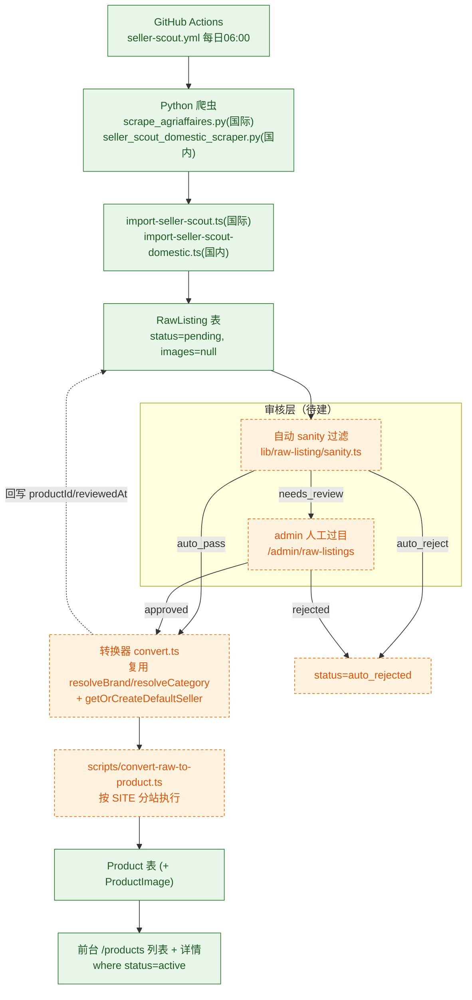
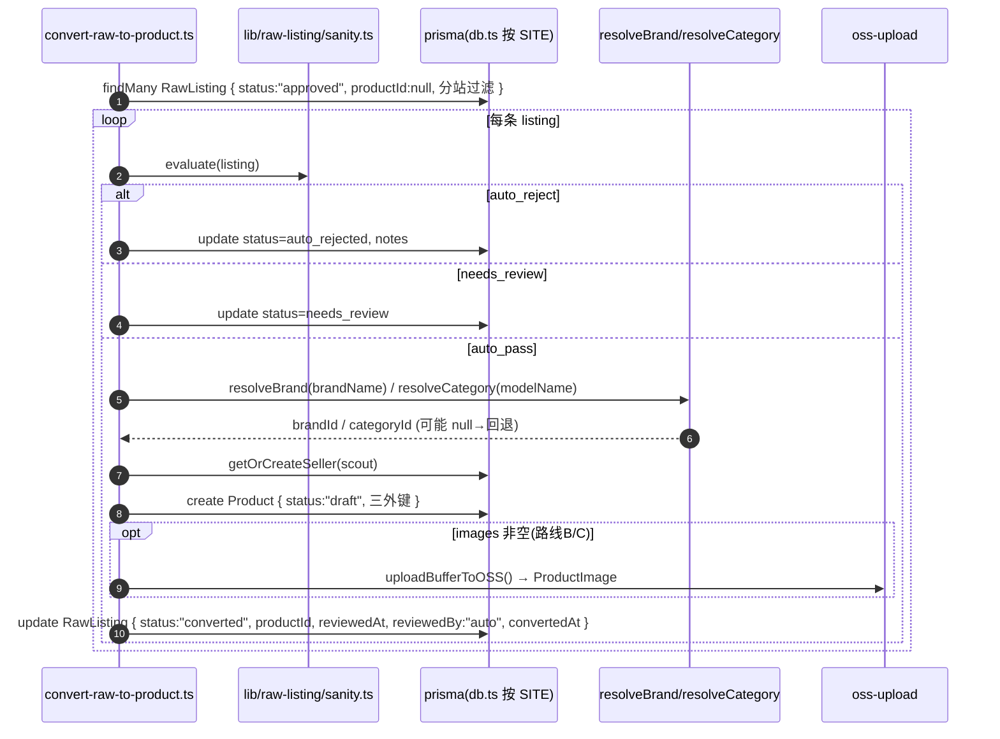

# 《采集数据上架》落地方案 (RawListing → Product)

> 目标：打通「卖方采集流水线 → 网站前台 Product」的**只进不出**断点，在**增量、non-breaking** 前提下，把 `RawListing`（约 805 行、`status` 全停在 `pending`）经「自动过滤 + 人工过目」转换为前台可读的 `Product`。
>
> 约束：不引入新框架，不改动现有 `Product` 前台展示逻辑，不改动既有三条创建路径（admin / seller / miniapp）。
>
> 技术栈：Next.js 14 App Router + Prisma + Tailwind/MUI（沿用现状）。

---

## 0. 现状复核（已核对，直接采信）

| 事实                                                                                          | 证据（文件:行号）                                                                                                                            |
| ------------------------------------------------------------------------------------------- | ------------------------------------------------------------------------------------------------------------------------------------ |
| `RawListing` 扁平表、无外键、`status @default("pending")`                                           | `prisma/schema.prisma:614-644`                                                                                                       |
| `Product` 三必填外键 `sellerId/brandId/categoryId`、`status @default("active")`                   | `prisma/schema.prisma:200-276`（外键 202-204，status 215）                                                                                |
| `ProductImage` 独立表                                                                          | `prisma/schema.prisma:278-288`                                                                                                       |
| 前台列表只读 `status: "active"` 的 `Product`                                                       | `src/app/[locale]/products/page.tsx:32-51`                                                                                           |
| 前台详情读 `Product`                                                                             | `src/app/[locale]/products/[id]/page.tsx:49`                                                                                         |
| 国际采集导入 → `RawListing`（`source:"agriaffaires"`，`images:null`）                                | `scripts/import-seller-scout.ts:100-122`                                                                                             |
| 国内采集导入 → `RawListing`（`source:"domestic_*"`，`images:null`）                                  | `scripts/import-seller-scout-domestic.ts:100-119`                                                                                    |
| 每日 06:00 采集工作流                                                                              | `.github/workflows/seller-scout.yml:7-11, 40-92`                                                                                     |
| **断点**：无 `RawListing→Product` 转换脚本；无 admin 审核页/接口；`status/reviewedAt/reviewedBy/notes` 无写入方 | 全仓检索无引用（`grep -r rawListing` 仅 `benchmark`/`daily-reports` 只读聚合统计）                                                                   |
| 可复用零件：品牌解析 / 品类解析 / 系统卖家 / 去重 / 内容安全                                                        | `resolve-brand.ts:65`、`resolve-category.ts:165`、`internal/products/route.ts:98-119`、`content-moderation.ts:37`、`wechat-sec-check.ts` |
| 双库分站机制（`.cn`→`DATABASE_URL_CN`，`.com`→`DATABASE_URL`）                                       | `src/lib/db.ts:22-41`、`src/config/site.ts:13`、`src/lib/data-residency.ts`                                                            |
| 国内源导入已有「数据不出境」合规护栏（拒绝非 cn-postgres）                                                         | `scripts/import-seller-scout-domestic.ts:13-28`                                                                                      |
| admin 鉴权：`getTokenFromHeaders + verifyToken`，角色 `admin/super_admin/editor`                  | `src/app/[locale]/admin/layout.tsx:22-41`、`src/app/api/admin/analytics/views/route.ts:23-37`                                         |
| 爬虫**不输出品类字段**；`modelName` 由页面标题推导                                                           | `scripts/scrape_agriaffaires.py:195-224`、`scripts/seller_scout_domestic_scraper.py:197-281`                                          |
| 旁路读取方：`benchmark`/`daily-reports` 按 `source startsWith "domestic_"` 计数（与 `status` 无关）       | `src/app/api/benchmark/route.ts:27,45`、`src/app/api/daily-reports/route.ts:96`                                                       |

**结论**：断点在「审核 + 转换」这一段。本方案不改三方创建路径，仅新增一条**旁路转换管线**，产物仍是标准 `Product`，前台零改动即可读取。

---

## 1. 实现方案总览



- 绿色（已有）：采集流水线与 `RawListing` 入库、`Product`/`ProductImage` 表、前台读取。
- 橙色虚线（待建）：自动 sanity 过滤、admin 人工审核、转换器与转换脚本、状态回写。

**核心设计原则**：转换器只做「读 `RawListing` → 解析外键 → 写 `Product`」，全程旁路；`RawListing` 只增 nullable 列（`productId`/`convertedAt`）用于幂等与溯源，不触碰任何既有列语义。

---

## 2. 审核策略（自动过滤 + 人工过目）

数据存在噪声（品牌中英双写、价格离群、youtube 噪声、各源有价率差异大），**不能无条件自动上架**。采用「三层判定」：每条 `RawListing` 由 `sanity.ts` 打分并给出 `recommendedAction`。

### 2.1 自动 sanity 规则（具体阈值）

| 规则                                                                                                                                    | 判定                                                    | 动作                                                                           |
| ------------------------------------------------------------------------------------------------------------------------------------- | ----------------------------------------------------- | ---------------------------------------------------------------------------- |
| **域名黑名单** `sourceUrl` host ∈ {`youtube.com`,`youtu.be`,`facebook.com`,`instagram.com`,`tiktok.com`,`pinterest.*`} 或 host 缺失/非 http(s) | 命中                                                    | `auto_reject`（噪声，如 `youtube.com/watch?v=...` 被当挂牌）                           |
| **modelName 噪声** 长度 < 2、含 `watch`/`http`/URL 片段、纯符号                                                                                   | 命中                                                    | `auto_reject`                                                                |
| **价格硬边界** `priceCny`（或 `priceRaw×汇率`）∉ `[3000, 20_000_000]`                                                                           | 命中                                                    | `auto_reject`（如 `克拉斯 Arion 460 €87.4 → ¥691`）                                |
| **价格离群（相对）** 与同品牌 或 同推断品类的中位价偏离 > 8× 或 < 1/8                                                                                          | 命中                                                    | `needs_review`（如 `MTZ Belarus 82.1 → ¥4,187,000`）                            |
| **无价行** `priceCny == null && priceRaw == null`                                                                                        | 命中                                                    | `needs_review`（agroline 87% / mascus 79% / **search_api 33%** 有价率差异 → 无价比例高） |
| **年份非法** `year == null` 或 `< 1980` 或 `> 当前年+1`                                                                                        | 命中                                                    | `needs_review`                                                               |
| **年份缺失但其余齐全**                                                                                                                         | —                                                     | `needs_review`（`Product.year` 为必填 `Int`）                                     |
| **品牌未匹配** `resolveBrand(brandName).matched == false`                                                                                  | 命中                                                    | `needs_review`（新品牌，需确认是否建档）                                                  |
| **品类无法推断**（见 §3，`RawListing` 无品类字段）                                                                                                   | 命中                                                    | `needs_review`                                                               |
| **重复检测** `checkDuplicateProduct(sellerId,brandId,modelName,year).isDuplicate`                                                         | 命中                                                    | `auto_reject`（已有同卖家同型号同年，避免刷屏，`content-moderation.ts:37-105`）                |
| **contentHash 冲突**                                                                                                                    | DB `@unique` 已保证导入层去重（`import-seller-scout.ts:91-99`） | 导入期拦截                                                                        |
| **condition 为空** `condition == null`                                                                                                  | 命中                                                    | 不阻塞，默认 `"used"`                                                              |

**判定优先级**：`auto_reject`(硬规则) > `needs_review`(软规则) > `auto_pass`。只有**零命中**的行才 `auto_pass`。

### 2.2 必须人工确认（强制进 `needs_review`）

1. **无价行**（`search_api` 尤其多）；
2. **离群价 / 超软阈值价**；
3. **新品牌**（`resolveBrand` 未命中 → 需确认「建档 or 丢弃」）；
4. **品类无法推断**（`RawListing` 无品类，回退到兜底品类时需过目）；
5. **可疑/聚合来源**（非白名单域、sourceUrl 缺失）；
6. **无图批量策略决策**（若选择「无图不上架」，是否回源抓图需人工确认）。

### 2.3 状态机（复用现有 `RawListing.status` 列，无需改枚举）

```
pending ──(sanity)──▶ auto_rejected        （自动拒绝，终态）
   │
   ├──(sanity)──────▶ needs_review ──(admin approve)──▶ approved ──(convert)──▶ converted ──(publish)──▶ published
   │                                    └─(admin reject)──▶ rejected（终态）
   └──(sanity)──────▶ approved（auto_pass）──(convert)──▶ converted ──(publish)──▶ published
```

- 审核动作统一回写：`status`、`reviewedAt = now()`、`reviewedBy = <admin userId | "auto">`、`notes` 追加判定摘要（含命中的规则名）。
- 设计上「审核」与「转换」解耦：`approved` 才允许转换；`converted/published` 不可再被自动规则改写。

---

## 3. 转换设计

### 3.1 逐字段映射表（`RawListing` → `Product`）

| 来源字段 (`RawListing`)                        | 目标 (`Product` / `ProductImage`)                        | 缺省 / 处理策略                                                                                        |
| ------------------------------------------ | ------------------------------------------------------ | ------------------------------------------------------------------------------------------------ |
| `brandName`                                | `brandId`                                              | `resolveBrand(brandName)`（`resolve-brand.ts:65`）；命中→取其 `brandId`；未命中→按 §3.2 建档 or `needs_review` |
| `modelName`                                | `modelName` (必填 String)                                | 非空校验；空 → 不转换                                                                                     |
| `year` (Int?)                              | `year` (必填 Int)                                        | 空/非法 → **不转换**（进 `needs_review`），不写 0/1900 脏值                                                    |
| `workingHours` (Int?)                      | `workingHours` (Int?)                                  | 直传，可空                                                                                            |
| `condition` (String?)                      | `condition` (必填 String)                                | 空 → 默认 `"used"`（对齐内部路由默认语义，`internal/products/route.ts:271`）                                     |
| `priceCny` (Float?)                        | `priceCny` (必填 Float)                                  | 空但有 `priceRaw`+`currency` → 按汇率折算；仍为空 → 不转换                                                      |
| `priceCny`                                 | `priceUsd` (Float?)                                    | `Math.round(priceCny / 7.25)`（对齐 `internal/products/route.ts:494`）                               |
| `location` (String)                        | `location` (必填 String)                                 | 直传；空 → 不转换                                                                                       |
| `source` / `sourceUrl`                     | （无对应列）→ `descriptionZh` 尾注 `数据来源：<source> <sourceUrl>` | 溯源用；不改表结构                                                                                        |
| `sellerName` (String?)                     | `contactName` (String?)                                | 仅当来源政策允许时回填（见 §5 PII 红线）                                                                         |
| `sellerPhone` (String?)                    | `contactPhone` (String?)                               | **国内源**可回填；**国际源默认丢弃**（第三方 ToS/合规风险，待明确）                                                         |
| `sellerWechat` (String?)                   | `contactWechat` (String?)                              | 国内源回填，国际源丢弃                                                                                      |
| `sellerWhatsapp` (String?)                 | （无列）→ `descriptionZh` 尾注 或 丢弃                          | 待明确                                                                                              |
| `images` (String? JSON)                    | `ProductImage` 多行                                      | 当前恒 `null`；非空时解析 JSON 数组 → 下载 → `uploadBufferToOSS` → `ProductImage`（见 §3.3）                     |
| `contentHash`                              | （不映射）                                                  | 仅用于幂等去重                                                                                          |
| `scrapedAt`                                | （不覆盖 `createdAt`）                                      | 保留溯源，不写入                                                                                         |
| `status`/`reviewedAt`/`reviewedBy`/`notes` | 回写来源                                                   | 审核/转换动作写入（见 §4）                                                                                  |
| （新增，nullable）`productId`                   | 转换产物 ID                                                | 幂等键：非空表示已转换，脚本跳过                                                                                 |
| （新增，nullable）`convertedAt`                 | 转换时间                                                   | 溯源                                                                                               |

> **建议的 schema 增量（additive-only）**：给 `RawListing` 增加两列 nullable `productId String?`、`convertedAt DateTime?`。不改任何既有列，不破坏 `benchmark`/`daily-reports` 的只读聚合（它们只按 `source` 计数，`route.ts:27,45` / `daily-reports/route.ts:96`）。

### 3.2 外键填充做法

- `sellerId`：复用 `getOrCreateDefaultSeller()` 思路（`internal/products/route.ts:98-119`），**新增一个采集专用系统卖家账号**（如 `email="scout@shendiao.com"`，`role:"seller"`，`credits` 充足），避免与「小程序发布」账号混用。将现有函数泛化为 `getOrCreateSeller(email, username, companyName)`。
- `brandId`：
  1. `resolveBrand(brandName)` → `matched` 直接取 `brandId`；
  2. 未命中且能归一化到同义词（`resolve-brand.ts:14-44`，如 `克拉斯`↔`Claas`、`纽荷兰`↔`New Holland`）→ 用标准名再查；
  3. 仍未命中 → **默认进 `needs_review`**，人工决定「建 Brand（`nameZh/nameEn/originCountry/isImported`）或丢弃」。`isImported` 影响前台展示语义（`internal/products/route.ts:129-138`、`INTERNATIONAL_BRANDS` 63-73），国际品牌应置 `true`。
- `categoryId`（**关键缺口**）：`RawListing` **无品类字段**，爬虫也不产出品类。填充策略（按优先级）：
  1. 对 `modelName`（源自页面标题，`scrape_agriaffaires.py:217-224`）做关键词分类，喂给 `resolveCategory()`（`resolve-category.ts:165`，内含 50+ 中英同义词如 combine/tractor/baler）；
  2. 命中 → 取 `categoryId`；
  3. 未命中 → 回退到兜底品类（如「农机配件」，由 `resolve-category.ts:139-146` 提供）并**标记 `notes`，进 `needs_review`**（因回退有误分风险）。

### 3.3 `images` 全空的降级策略（当前 100% 为 `null`）

当前 `RawListing.images` 导入时恒为 `null`（`import-seller-scout.ts:118`、`import-seller-scout-domestic.ts:116`）。三条路线：

| 路线                   | 说明                                                                                          | 取舍                        |
| -------------------- | ------------------------------------------------------------------------------------------- | ------------------------- |
| **A. 允许无图上架**（P0 默认） | `Product` 无 `ProductImage` 行；前台 `images: take(1)` 取不到时由现有占位逻辑兜底（需验证前台无图渲染，见 §8）             | 成本最低，立刻闭环；但影响转化率与 SEO     |
| **B. 回源抓图**（P1）      | 转换时按 `sourceUrl` 二次抓取主图 → 下载 → `uploadBufferToOSS`（`src/lib/oss-upload.ts`）→ `ProductImage` | 有额外抓取/合规成本；国际源图片版权与防盗链需评估 |
| **C. 仅抓图不阻塞**（P1 折中） | 转换先建 `Product`（无图），抓图任务异步补 `ProductImage`，失败不阻塞                                             | 平衡时效与质量                   |

> 建议 P0 = A（先打通闭环），P1 = C（异步补图）。**是否允许无图商品展示，是必须老板拍板的事项（§8）。**

### 3.4 转换示意（序列图）




## 5. 合规分站

### 5.1 分站判定与执行

复用现成分站机制：`process.env.SITE`（`src/config/site.ts:13`）+ `DATABASE_URL / DATABASE_URL_CN`（`src/lib/db.ts:22-41`）。转换脚本按运行站点**只处理本站合法来源**：

| 站点                           | 环境                            | 允许处理的 `RawListing.source`                       | 禁止                                                             |
| ---------------------------- | ----------------------------- | ----------------------------------------------- | -------------------------------------------------------------- |
| `.cn`（阿里云 ECS + 境内 postgres） | `SITE=cn` + `DATABASE_URL_CN` | `domestic_*`（国内采集）                              | 国际源（`agriaffaires`/`agroline`/`mascus`/`search_api`）——**不得出现** |
| `.com`（Vercel + Neon 境外）     | `SITE=com` + `DATABASE_URL`   | `agriaffaires`/`agroline`/`mascus`/`search_api` | `domestic_*`（国内 PII）——**不得写出境**                                |

### 5.2 跨站禁止条件（硬护栏）

在 `convert-raw-to-product.ts` 开头，仿照国内导入护栏（`import-seller-scout-domestic.ts:17-28`）加**启动断言**：

1. `SITE=cn` 但未设 `DATABASE_URL_CN` → **拒绝运行**（`exit 2`）；
2. `.cn` 站若查询命中任何国际源 `source` → 该行跳过并告警（数据不出境反向保护）；
3. `.com` 站若查询命中 `source startsWith "domestic_"` → **立即拒绝**（国内 PII 不得出境，红线）；
4. 复用 `src/lib/data-residency.ts` 的 `assertDomesticWrite/assertOverseasWrite` 语义对写入做二次断言。

### 5.3 PII 处理红线

- **国内源**：`sellerName/sellerPhone/sellerWechat` 属个人信息，仅落 `.cn`；回填 `Product.contact*` 需符合境内隐私告知。
- **国际源**：从第三方站点抓取的卖家姓名/电话回填 `contactPhone` 有 **ToS 与合规风险**，**默认丢弃**，仅保留 `contactName`（可选）。此项列入 §8 待拍板。

---

## 6. 交付物清单（拟新建 / 修改文件）

**新建**

| 文件（相对路径）                                            | 作用                                                             |
| --------------------------------------------------- | -------------------------------------------------------------- |
| `src/lib/raw-listing/types.ts`                      | 审核结果、状态枚举、转换入参/出参类型                                            |
| `src/lib/raw-listing/sanity.ts`                     | 自动过滤规则库（§2.1 全部阈值 + 黑名单 + 中位数离群）                               |
| `src/lib/raw-listing/convert.ts`                    | 核心映射：`RawListing → Product`（供脚本与 API 复用）                       |
| `scripts/convert-raw-to-product.ts`                 | 按 `SITE` 分站执行的转换入口（含 §5 合规断言）                                  |
| `src/app/api/admin/raw-listings/route.ts`           | `GET` 待审列表（分页/筛选）+ `POST` 批量动作（approve/reject/convert/publish） |
| `src/app/api/admin/raw-listings/[id]/route.ts`      | `PATCH` 单条审核动作 / 触发转换                                          |
| `src/app/[locale]/admin/raw-listings/page.tsx`      | 审核列表页（复用 `admin/products/page.tsx` 表格范式）                       |
| `src/app/[locale]/admin/raw-listings/[id]/page.tsx` | （可选 P1）单条详情/预览/逐条放行                                            |
| `src/components/admin/raw-listing-actions.tsx`      | （可选 P1）客户端操作组件（对齐 `delete-product-button.tsx` 范式）              |
| `docs/采集数据上架-runbook.md`                            | （可选 P2）运维手册 + 拍板项记录                                            |

**修改（增量、non-breaking）**

| 文件                                         | 改动                                                                       |
| ------------------------------------------ | ------------------------------------------------------------------------ |
| `prisma/schema.prisma`                     | `RawListing` 增 nullable `productId String?`、`convertedAt DateTime?` + 迁移 |
| `src/app/[locale]/admin/admin-sidebar.tsx` | 侧栏新增「采集审核」入口（`links` 数组，`:24-38`）                                        |
| `.github/workflows/seller-scout.yml`       | （可选 P2）采集后追加非自动的转换触发，或保持纯手动                                              |
| `package.json`                             | （可选）新增 `"convert:raw": "tsx scripts/convert-raw-to-product.ts"`          |

> 不改动：`src/app/[locale]/products/**`（前台）、`src/app/api/internal/products/route.ts`、既有 admin/seller/miniapp 创建路径。

---

## 7. 任务分解（有序、含依赖）

> 按架构规范：≤ 5 个任务，每任务 ≥ 3 个相关文件，T01 为项目基础设施。

| 任务      | 名称               | 源文件                                                                                                                                   | 依赖  | 优先级                     |
| ------- | ---------------- | ------------------------------------------------------------------------------------------------------------------------------------- | --- | ----------------------- |
| **T01** | 数据契约与自动规则库（基础设施） | `prisma/schema.prisma`(+迁移)、`src/lib/raw-listing/types.ts`、`src/lib/raw-listing/sanity.ts`                                            | —   | **P0**                  |
| **T02** | 转换核心与转换脚本        | `src/lib/raw-listing/convert.ts`、`scripts/convert-raw-to-product.ts`、`src/lib/oss-upload.ts`(可选补图)、`package.json`(script)             | T01 | **P0**                  |
| **T03** | 审核后端 API         | `src/app/api/admin/raw-listings/route.ts`、`.../[id]/route.ts`                                                                         | T01 | **P0**                  |
| **T04** | 审核前端页 + 侧栏入口     | `src/app/[locale]/admin/raw-listings/page.tsx`、`[id]/page.tsx`(可选)、`src/components/admin/raw-listing-actions.tsx`、`admin-sidebar.tsx` | T03 | **P0**（详情页 P1）          |
| **T05** | 分站护栏 + 自动化与治理    | `.github/workflows/seller-scout.yml`(改)、`docs/采集数据上架-runbook.md`、分站断言逻辑收口                                                             | T02 | **P1**（workflow 自动化 P2） |

**P0 最小闭环** = T01 → T02（可 CLI 手动跑 `convert`）+ T03 → T04（人工在后台过目、转换、发布 `draft→active`）。

---

## 8. 待明确事项（需老板/PM 拍板）

1. **是否允许无人值守自动上架？** 若允许，自动上架的 confidence 阈值如何定（是否要求「有价 + 品牌已匹配 + 有图」三选全中）？
2. **每源/每日上架上限？** 一次新采集可能涌入大量挂牌，是否需要「每源每日 ≤ N 条」或「单次转换 ≤ N 条」限流？
3. **无图商品是否展示？**（当前 `images` 恒 `null`）→ 决定走 §3.3 路线 A/B/C；若允许无图，前台是否有占位图兜底（需前台侧确认）？
4. **是否回源抓图？** 涉及额外抓取成本与第三方图片版权/防盗链。
5. **采集来源 PII 是否可用？** 国际源 `sellerName/sellerPhone` 是否允许落库/回填 `Product.contact*`（ToS 风险）；国内源隐私告知口径。
6. **审核责任人是谁？** 角色限定 `admin/super_admin/editor`（`admin/layout.tsx:39`）中的哪一类；是否需要操作审计留痕。
7. **转换后 `Product.status` 取 `draft` 还是 `active`？**（§4.1，建议 P0 取 `draft`）
8. **品类缺口兜底是否接受？** `RawListing` 无品类；回退到「农机配件/其他农机」并标记人工复核，是否可接受？
9. **品牌中英双写如何归一？** 是否借本次转换统一 `Brand`（合并 `Claas`/`克拉斯`、`New Holland`/`纽荷兰`），并同步修正既有重复品牌行？此项影响面较大，可能需独立小任务。
10. **价格离群处理口径**：直接 `auto_reject`，还是统一进 `needs_review` 交人工？

---

### 附：关键风险与缓解

| 风险        | 缓解                                     |
| --------- | -------------------------------------- |
| 品类缺失导致误分类 | 关键词分类 + 兜底品类 + 强制 `needs_review` 标记    |
| 品牌未建档被丢弃  | `resolveBrand` 同义词优先；未命中只进 review 不自动建 |
| 价格噪声直达前台  | P0 一律 `draft`，前台仅读 `active`            |
| 跨站数据出境    | 脚本启动硬断言 + `data-residency` 二次校验（§5）    |
| 重复转换      | `RawListing.productId != null` 幂等跳过    |
| 前台无图渲染未知  | §8-3 拍板前先在前台侧验证占位逻辑                    |
